# 电商运营助手 · 单品运营闭环工作台

面向中小电商团队的运营工作台。围绕**单个商品**完成从建档到复盘的一条完整闭环：

```
建店建档 → 录入商品 → 补充竞品 → 生成诊断 → 生成主图方案 → 生成视频脚本
   → 生成素材 → 人工审核素材 → 生成投放建议 → 人工确认 → 回填经营数据
   → 生成复盘报告 → 复盘结论回到诊断环节（下一轮优化闭环）
```

所有诊断、方案、素材、投放建议与复盘报告都挂在具体商品下，不能脱离商品存在。

---

## 目录

- [界面预览](#界面预览)
- [快速开始](#快速开始)
- [演示账号与角色权限](#演示账号与角色权限)
- [完整演示链路（建议按此顺序验收）](#完整演示链路建议按此顺序验收)
- [技术栈与项目结构](#技术栈与项目结构)
- [接口说明](#接口说明)
- [导入中心与模板](#导入中心与模板)
- [异步任务机制](#异步任务机制)
- [数据表](#数据表)
- [内容生成（AI 层）说明](#内容生成ai-层说明)
- [合规边界](#合规边界)
- [验收自查清单](#验收自查清单)
- [常见问题](#常见问题)

---

## 界面预览

### 主要页面

| 界面 | 截图 |
| --- | --- |
| 工作台 | 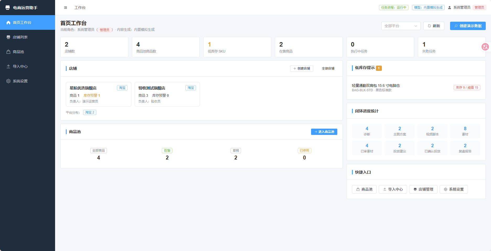 |
| 店铺列表 | 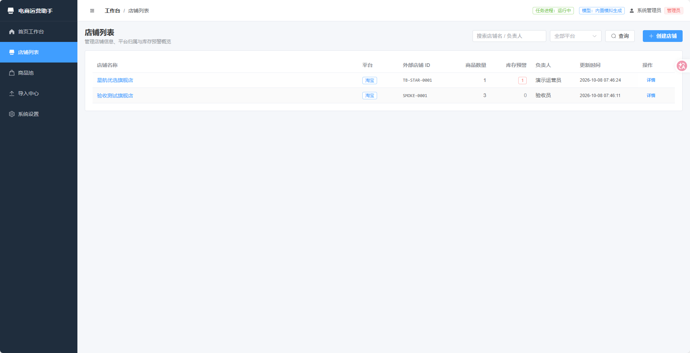 |
| 店铺详情 | 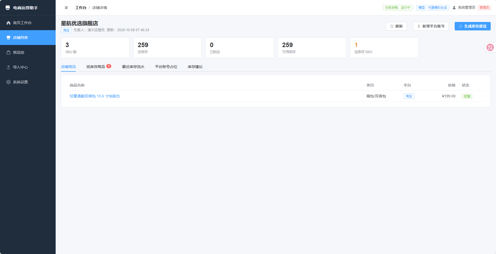 |
| 商品池 | 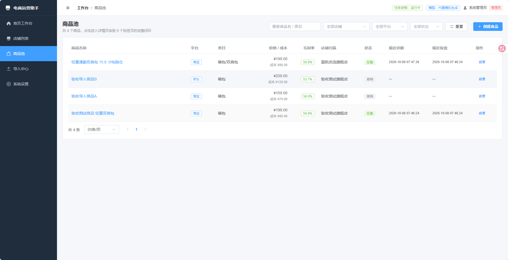 |
| 导入中心 | 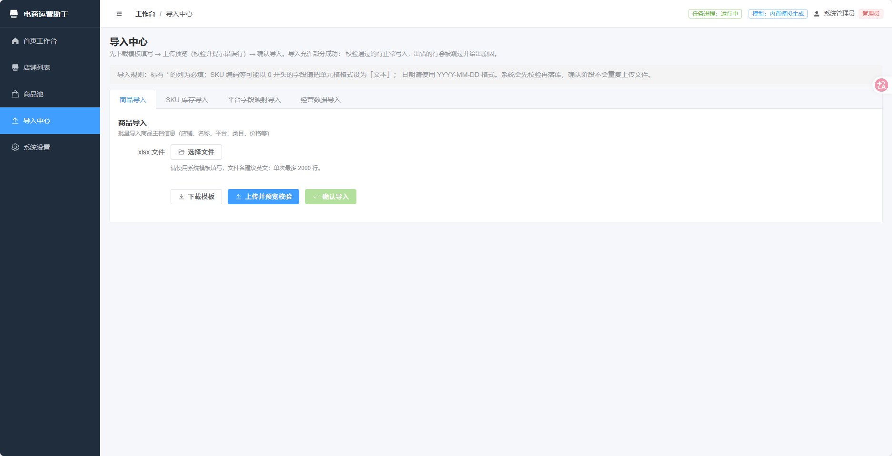 |
| 系统设置 | 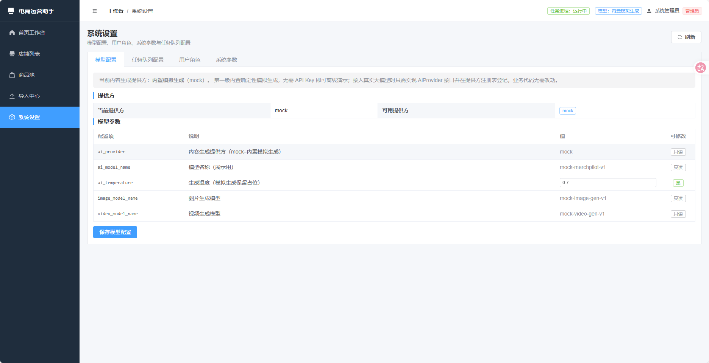 |

### 商品详情与闭环标签

| 界面 | 截图 |
| --- | --- |
| 商品详情 | 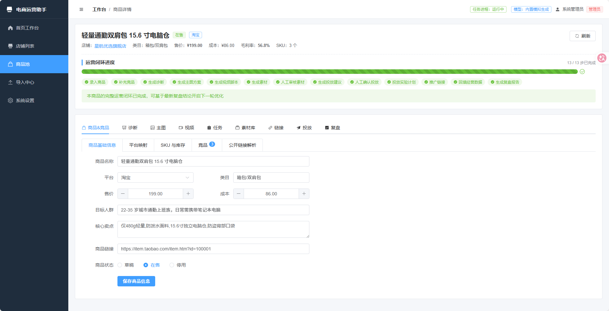 |
| 诊断 | 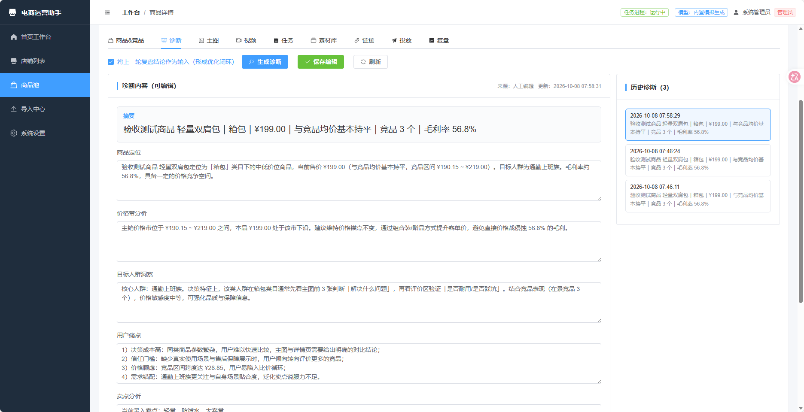 |
| 主图 | 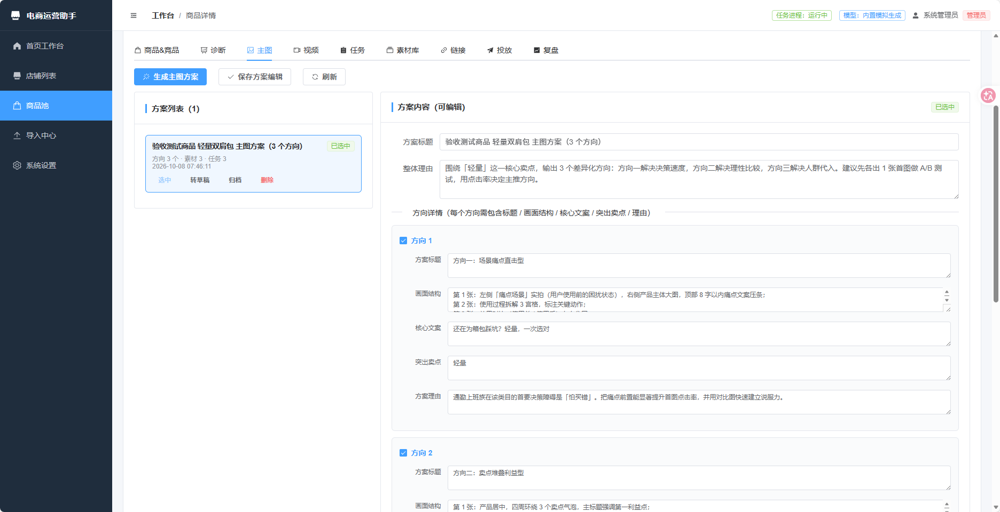 |
| 视频 |  |
| 任务列表 | 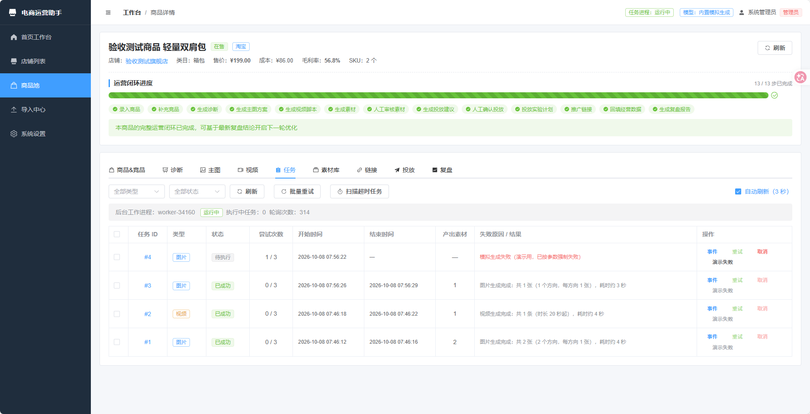 |
| 素材库 | 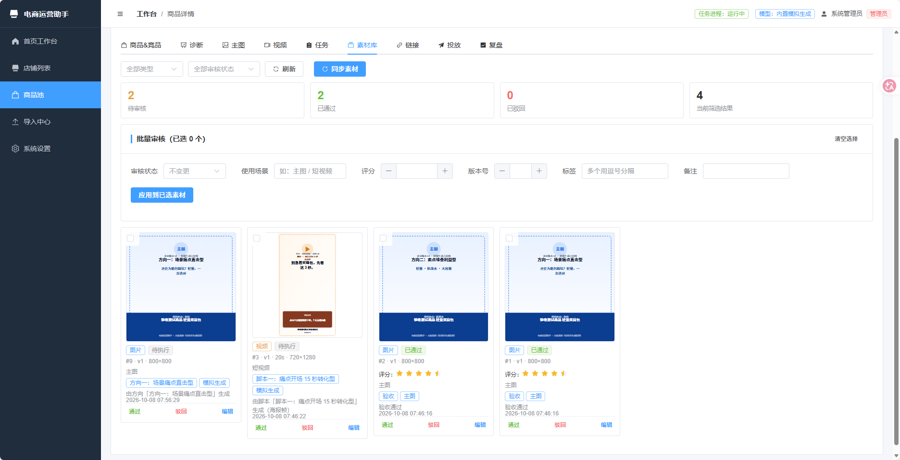 |
| 投放建议 | 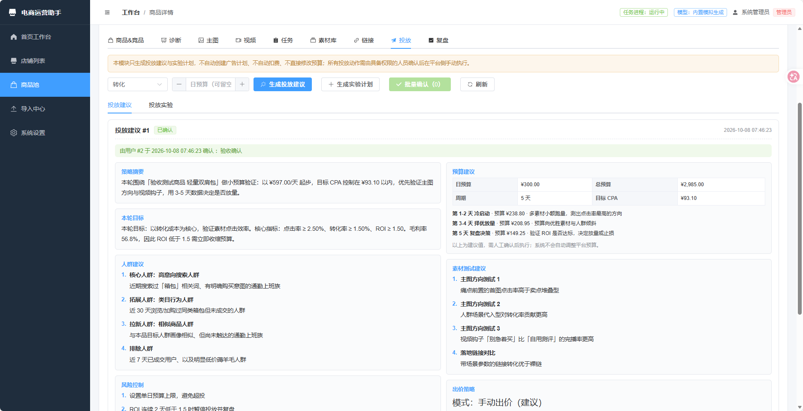 |
| 复盘 | 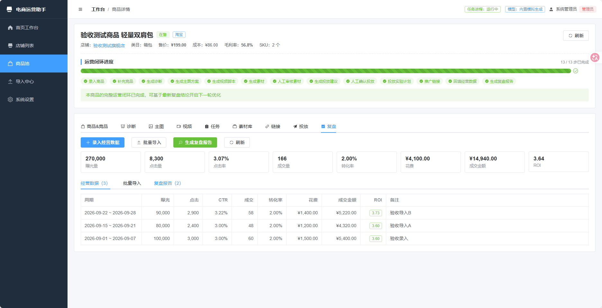 |

---

## 快速开始

### 环境要求

| 组件 | 版本 | 说明 |
| --- | --- | --- |
| Python | 3.12+ | 后端 |
| Node.js | 18+ | 仅构建前端需要；不构建也可只用后端 |

### 一键启动（Windows）

```bat
start.bat
```

脚本会自动：创建虚拟环境 → 安装 Python 依赖（清华镜像）→ 安装并构建前端 → 启动服务。

### 手动启动

```bash
# 1) 安装后端依赖（PyPI 直连不可用时用清华镜像）
.venv/Scripts/python.exe -m ensurepip
.venv/Scripts/python.exe -m pip install -i https://pypi.tuna.tsinghua.edu.cn/simple \
    fastapi uvicorn sqlalchemy pydantic pydantic-settings pyjwt openpyxl python-multipart

# 2) 构建前端（可选；不构建则仅提供 API）
cd frontend
npm install
npm run build
cd ..

# 3) 初始化数据库（可选，服务启动时也会自动建表并写入种子账号）
cd backend
../.venv/Scripts/python.exe scripts/init_db.py

# 4) 启动服务
../.venv/Scripts/python.exe -m uvicorn app.main:app --host 127.0.0.1 --port 8004
```

访问地址：

| 入口 | 地址 |
| --- | --- |
| 前端工作台 | <http://127.0.0.1:8004> |
| 接口文档（Swagger） | <http://127.0.0.1:8004/docs> |
| 接口文档（ReDoc） | <http://127.0.0.1:8004/redoc> |
| 健康检查 | <http://127.0.0.1:8004/api/health> |

### 前端开发模式（热更新）

```bash
# 终端 1：后端
cd backend && ../.venv/Scripts/python.exe -m uvicorn app.main:app --reload --port 8004

# 终端 2：前端（Vite 已配置 /api 与 /static 代理到 8004）
cd frontend && npm run dev
# 打开 http://localhost:5175
```

---

## 演示账号与角色权限

服务首次启动会自动创建三个演示账号：

| 用户名 | 密码 | 角色 | 权限范围 |
| --- | --- | --- | --- |
| `admin` | `admin123` | 管理员 | 全部权限：用户管理、店铺管理、平台账号、业务编辑、投放确认、演示数据 |
| `operator` | `operator123` | 运营人员 | 商品/竞品/方案/素材/经营数据编辑、导入、任务重试取消、投放确认；**不能**管理用户与店铺 |
| `viewer` | `viewer123` | 查看人员 | 只读，所有写操作返回 403 |

权限实现要点：

- 所有写操作在**路由级**挂载 `require_editor` / `require_admin` / `require_ad_confirm` 依赖，未登录返回 401，角色不符返回 403。
- **投放确认**（`PATCH /ad-recommendations/{id}/confirmation`）与**实验状态更新**（`PATCH /ad-experiments/{id}`）使用独立的 `require_ad_confirm` 校验。
- **用户管理**整个路由只允许 `admin`。
- 角色**每次请求**都从数据库重新读取，因此在设置页调整角色后**立即生效**（无需重新登录）。
- 前端 `v-permission` 指令与路由 `meta.roles` 只做界面收敛，真正的校验始终在后端。

---

## 完整演示链路（建议按此顺序验收）

> 最快的体验方式：用 `admin` 登录 → 工作台右上角点「创建演示数据」→ 系统会一次性铺满整条闭环数据 → 直接进入商品详情页逐个标签查看。

如果想完整走一遍**从零开始**的流程：

### 1. 建店建档

1. 登录 `admin` → 左侧「店铺列表」→「创建店铺」
2. 进入店铺详情页 → 「平台账号占位」标签 → 「新增平台账号」
   - 注意：表单**没有**密码/token/cookie 字段，这是刻意的合规设计
3. 点「发起授权占位」→ 查看生成的占位授权链接 → 「模拟回填授权元数据」
4. 回到「库存建议」标签 → 「生成库存建议」

### 2. 录入商品

1. 左侧「商品池」→「创建商品」→ 创建后自动进入详情页
2. 详情页默认在「商品&竞品」标签：
   - 「商品基础信息」子标签：编辑并保存商品信息
   - 「平台映射」子标签：新增平台商品 ID 映射
   - 「SKU 与库存」子标签：新增 SKU（自动建库存记录 + 期初流水）→ 用「调库存」做一次调整 → 点「流水」查看库存流水

### 3. 补充竞品

1. 同页「竞品」子标签 →「录入竞品」手工录入 1-2 个
2. 切到「公开链接解析」子标签 → 粘贴公开商品链接（每行一个）→「创建解析任务」→「运行」
   - 解析成功后会自动创建竞品记录
3. 回「竞品」子标签 → 给竞品「加监控」→「运行到期监控」生成快照 →「快照」查看价格/销量变化

### 4. 生成诊断

1. 切到「诊断」标签 → 勾选「将上一轮复盘结论作为输入」→「生成诊断」
2. 输出包含：**商品定位 / 价格带分析 / 目标人群洞察 / 用户痛点 / 卖点分析 / 风险点 / 优化建议**，全部可在页面上直接编辑
3. 编辑后点「保存编辑」，右侧「历史诊断」可切换查看历史版本

### 5. 生成主图方案

1. 切到「主图」标签 →「生成主图方案」
2. 输出 **3 个方向**，每个方向含：方案标题 / 画面结构 / 核心文案 / 突出卖点 / 方案理由
3. 勾选要生成的方向 → 点「提交图片生成任务（异步）」→ 立即返回，不阻塞页面
4. 用方案卡片上的「选中 / 转草稿 / 归档」切换状态（同一商品同一类型只允许一个「选中」）

### 6. 生成视频脚本

1. 切到「视频」标签 →「生成视频脚本」
2. 输出 **3 条脚本**，每条含：开头钩子 / 镜头分镜 / 口播文案 / 转化引导
3. 勾选脚本 →「提交视频生成任务（异步）」

### 7. 查看任务与事件时间线

1. 切到「任务」标签（页面每 3 秒自动刷新，切走即停止轮询）
2. 观察状态流转：`待执行 → 执行中 → 已成功`
3. 点任务 ID 或「事件」→ 查看**事件时间线**：入队 / 运行中 / 成功 / 失败 / 重试 / 取消 / 超时
4. 演示失败与重试：用 admin 点「演示失败」标记任务 → 任务会**自动重试**（指数退避）→ 达到最大次数后进入「已失败」→ 点「重试」重新入队
5. 演示取消：新建任务后立刻点「取消」
6. 演示超时：admin 点「扫描超时任务」

### 8. 人工审核素材

1. 切到「素材库」标签 → 查看图片与视频素材（视频含 `duration_sec` 时长）
2. 单个操作：卡片下方「通过 / 驳回 / 编辑」
3. 批量操作：勾选多个素材 → 在上方「批量审核」区设置审核状态 / 使用场景 / 评分 / 版本号 / 标签 / 备注 →「应用到已选素材」
4. 「同步素材」用于把已完成任务产出的素材同步入库

### 9. 生成投放建议并人工确认

1. 切到「投放」标签 → 选择本轮目标与日预算 →「生成投放建议」
2. 输出包含 8 项：**策略摘要 / 本轮目标 / 人群建议 / 预算建议 / 素材测试建议 / 出价策略 / 风险控制 / 下一步动作**
3. 建议初始为「待确认」→ 点「确认」或「驳回」→ 记录确认人与确认时间
4. **权限验证**：用 `viewer` 登录尝试确认 → 返回 403
5. 点「生成实验计划」→ 实验初始为「草稿」→ 按 `草稿 → 已确认 → 执行中 → 已结束` 流转（终态不可回退，非法流转返回 409）

### 10. 回填经营数据

1. 切到「复盘」标签 → 「录入经营数据」→ 填写曝光/点击/成交/花费/成交金额
   - CTR、转化率、ROI 会**自动计算**；也可手工覆盖
2. 或用「批量导入」：下载模板 → 填写 → 上传预览（逐行校验 + 错误行提示）→ 确认导入（**允许部分成功**）

### 11. 生成复盘报告并闭环

1. 同页「复盘报告」标签 →「生成复盘报告」→ 选择周期
2. 输出包含：**周期摘要 / 核心洞察 / 问题判断 / 下一步动作**
3. 报告下方会提示闭环入口：报告中的「下一步动作」会在下一次生成诊断时**自动作为输入**
4. 回到「诊断」标签 → 再点「生成诊断」→ 诊断结果里会带上「上一轮复盘遗留动作」，形成**优化闭环**

---

## 技术栈与项目结构

### 技术栈

| 层次 | 选型 |
| --- | --- |
| 后端 | Python 3.12 + FastAPI + SQLAlchemy 2.x（同步）+ Uvicorn |
| 数据库 | SQLite（WAL 模式，零配置单文件） |
| 鉴权 | PyJWT + `hashlib.pbkdf2_hmac`（SHA-256，10 万次迭代） |
| 前端 | Vue 3 + Vite + Element Plus（zh-CN）+ Pinia + Vue Router + Axios |
| 导入导出 | openpyxl（运行时生成模板，不在仓库中放二进制） |
| 内容生成 | 内置确定性模拟生成（`AiProvider` 抽象，可替换为真实大模型） |

### 目录结构

```
star-merchPilot/
├── start.bat                  # Windows 一键启动
├── pyproject.toml             # Python 依赖声明
├── backend/
│   ├── app/
│   │   ├── main.py            # 应用工厂：lifespan → API 路由 → 静态挂载 → SPA 兜底
│   │   ├── config.py          # 配置（可用 SM_ 前缀环境变量覆盖）
│   │   ├── database.py        # 引擎、会话、PRAGMA、统一 UTC 时间
│   │   ├── security.py        # 口令哈希与 JWT
│   │   ├── seed.py            # 幂等种子数据（演示账号 + 系统参数）
│   │   ├── serializers.py     # ORM → 对外 JSON
│   │   ├── models/            # 23 张业务表 + system_settings
│   │   ├── schemas/           # Pydantic 请求模型
│   │   ├── api/
│   │   │   ├── deps.py        # 当前用户、角色校验依赖
│   │   │   └── v1/            # 各领域路由（见下方「后端模块对照」）
│   │   ├── services/          # 业务服务（不依赖 FastAPI）
│   │   ├── providers/         # 内容生成提供方（抽象 + 模拟实现 + 注册表）
│   │   └── worker/            # 生成任务工作进程与执行器
│   ├── scripts/
│   │   ├── init_db.py         # 数据库初始化（支持 --reset / --demo）
│   │   ├── export_schema.py   # 从模型导出 schema.sql
│   │   ├── schema.sql         # 数据库结构（自动导出）
│   │   ├── smoke.py           # 端到端接口验收脚本
│   │   └── ui_check.py        # 前端浏览器冒烟检查（Playwright）
│   └── storage/               # 运行时生成：app.db、assets/、tmp/、ui-shots/
└── frontend/
    └── src/
        ├── api/               # 接口层（每领域一个模块）
        ├── router/            # 路由表 + 角色守卫
        ├── stores/            # Pinia：auth / app / product
        ├── directives/        # v-permission 指令
        ├── components/        # StatusTag / AiBlock / JobEventsTimeline
        ├── layouts/           # MainLayout（角色过滤菜单）
        └── views/             # 页面；商品详情 9 个标签在 views/tabs/
```

### 后端模块对照（规格 1.5.7）

| 规格模块 | 实现位置 |
| --- | --- |
| 认证模块 | `api/deps.py`、`api/v1/auth.py`、`security.py` |
| 用户模块 | `api/v1/users.py` |
| 店铺模块 | `api/v1/stores.py` |
| 商品模块 | `api/v1/products.py` |
| SKU 与库存模块 | `api/v1/products.py`（SKU/库存/流水/预警） |
| 竞品模块 | `api/v1/competitors.py`、`services/parse_service.py`、`services/monitor_service.py` |
| 诊断模块 | `api/v1/diagnoses.py` |
| 方案模块 | `api/v1/creative_plans.py` |
| 任务模块 | `api/v1/jobs.py`、`worker/`、`services/job_service.py` |
| 素材模块 | `api/v1/assets.py`、`services/asset_service.py` |
| 链接模块 | `api/v1/links.py`、`services/link_service.py` |
| 投放模块 | `api/v1/ad.py` |
| 经营分析模块 | `api/v1/performance.py`、`api/v1/review.py` |
| 工作区模块 | `api/v1/workspace.py`、`services/demo_service.py`、`services/template_service.py` |

---

## 接口说明

完整交互式文档见 **<http://127.0.0.1:8004/docs>**（FastAPI 自动生成，可直接在线调试）。

约定：

- 除登录接口与推广短链跳转外，所有接口都需要 `Authorization: Bearer <token>`。
- 列表接口统一返回 `{"total": n, "items": [...]}`。
- 错误统一返回 `{"detail": "中文错误说明"}`；权限不足 403、资源不存在 404、状态冲突 409。

### 规格要求接口对照

| 方法 | 路径 | 说明 |
| --- | --- | --- |
| POST | `/api/v1/auth/login` | 登录并返回访问令牌 |
| GET | `/api/v1/auth/me` | 当前登录用户 |
| GET/POST | `/api/v1/users` | 用户列表 / 创建（仅管理员） |
| PATCH | `/api/v1/users/{user_id}` | 更新用户角色、状态（仅管理员） |
| GET/POST | `/api/v1/stores` | 店铺列表 / 创建 |
| GET/PATCH | `/api/v1/stores/{store_id}` | 店铺详情 / 更新 |
| POST | `/api/v1/stores/{store_id}/platform-accounts` | 创建平台账号占位 |
| POST | `/api/v1/stores/{store_id}/platform-accounts/{account_id}/authorization/start` | 生成授权占位信息 |
| POST | `/api/v1/stores/{store_id}/platform-accounts/{account_id}/authorization/callback-placeholder` | 保存授权元数据 |
| POST | `/api/v1/stores/{store_id}/inventory-advice/generate` | 生成库存建议 |
| GET/POST | `/api/v1/products` | 商品列表 / 创建 |
| GET/PATCH | `/api/v1/products/{product_id}` | 商品详情 / 更新 |
| POST | `/api/v1/products/{product_id}/platform-mappings` | 商品平台映射 |
| POST | `/api/v1/products/{product_id}/competitors` | 录入竞品 |
| POST | `/api/v1/products/{product_id}/competitors/import-url-tasks` | 创建公开链接解析任务 |
| POST | `/api/v1/products/{product_id}/link-parse-tasks/{task_id}/run` | 运行公开链接解析任务 |
| POST | `/api/v1/products/{product_id}/competitors/{competitor_id}/monitor` | 创建竞品监控 |
| POST | `/api/v1/products/{product_id}/diagnoses/generate` | 生成商品诊断 |
| PATCH | `/api/v1/products/{product_id}/diagnoses/{diagnosis_id}` | 编辑诊断 |
| POST | `/api/v1/products/{product_id}/creative-plans/main-images/generate` | 生成主图方案 |
| POST | `/api/v1/products/{product_id}/creative-plans/video-scripts/generate` | 生成视频脚本 |
| PATCH | `/api/v1/products/{product_id}/creative-plans/{creative_plan_id}` | 编辑方案 / 切换状态 |
| POST | `/api/v1/products/{product_id}/creative-plans/{creative_plan_id}/images/generate` | 创建图片生成任务 |
| POST | `/api/v1/products/{product_id}/creative-plans/{creative_plan_id}/videos/generate` | 创建视频生成任务 |
| POST | `/api/v1/products/{product_id}/generation-jobs/{job_id}/retry` | 重试失败任务 |
| POST | `/api/v1/products/{product_id}/generation-jobs/{job_id}/cancel` | 取消任务 |
| POST | `/api/v1/workspace/generation-jobs/sweep-timeouts` | 扫描超时任务（仅管理员） |
| POST | `/api/v1/products/{product_id}/assets/sync` | 同步素材 |
| PATCH | `/api/v1/products/{product_id}/creative-plans/{creative_plan_id}/assets` | 更新素材审核字段 |
| POST | `/api/v1/products/{product_id}/promotion-links/generate` | 生成推广链接建议 |
| POST | `/api/v1/products/{product_id}/promotion-links` | 创建推广链接 |
| GET | `/api/v1/r/{tracking_code}` | 推广链接跳转并记录点击（**无需登录**） |
| POST | `/api/v1/products/{product_id}/ad-recommendations/generate` | 生成投放建议 |
| PATCH | `/api/v1/products/{product_id}/ad-recommendations/{recommendation_id}/confirmation` | 人工确认 / 驳回（独立权限校验） |
| POST | `/api/v1/products/{product_id}/ad-experiments/generate` | 生成投放实验计划 |
| PATCH | `/api/v1/products/{product_id}/ad-experiments/{experiment_id}` | 更新实验状态（独立权限校验） |
| POST | `/api/v1/products/{product_id}/performance-records` | 录入经营数据 |
| POST | `/api/v1/products/{product_id}/performance-records/import` | 批量导入经营数据（两段式） |
| POST | `/api/v1/products/{product_id}/review-reports/generate` | 生成复盘报告 |
| POST | `/api/v1/workspace/demo-data` | 创建演示数据（仅管理员） |
| GET | `/api/v1/workspace/templates/products` | 下载商品导入模板 |
| GET | `/api/v1/workspace/templates/sku-inventory` | 下载 SKU 库存导入模板 |
| GET | `/api/v1/workspace/templates/performance-records` | 下载经营数据导入模板 |
| POST | `/api/v1/workspace/competitor-monitors/run-due` | 运行到期竞品监控 |

### 支撑接口（前端使用）

| 方法 | 路径 | 说明 |
| --- | --- | --- |
| GET | `/api/v1/workspace/dashboard` | 首页工作台聚合数据（店铺卡片、低库存、商品池、闭环统计） |
| GET | `/api/v1/workspace/settings` / PATCH | 系统设置（模型 / 队列 / 系统参数） |
| GET | `/api/v1/workspace/worker-status` | 后台工作进程状态 |
| GET | `/api/v1/products/{id}/timeline` | 商品闭环进度 |
| GET | `/api/v1/products/{id}/generation-jobs` | 商品任务列表 |
| GET | `/api/v1/products/{id}/generation-jobs/{job_id}/events` | 任务事件时间线 |
| GET | `/api/v1/imports` | 导入中心支持的类型 |
| POST | `/api/v1/imports/{type}/preview` / `confirm` | 商品 / SKU 库存 / 平台字段映射导入 |

---

## 导入中心与模板

支持 **4 类导入**，每一类都提供模板下载 → 上传预览 → 确认导入：

| 导入类型 | 模板接口 | 导入接口 |
| --- | --- | --- |
| 商品导入 | `/workspace/templates/products` | `/imports/products/preview` + `confirm` |
| SKU 库存导入 | `/workspace/templates/sku-inventory` | `/imports/sku-inventory/preview` + `confirm` |
| 平台字段映射导入 | `/workspace/templates/platform-mappings` | `/imports/platform-mappings/preview` + `confirm` |
| 经营数据导入 | `/workspace/templates/performance-records` | `/products/{id}/performance-records/import` |

### 两段式导入流程

```
1. 上传 xlsx → 服务端逐行校验（必填、枚举、数值范围、重复编码…）
2. 返回预览：{import_id, total_rows, valid_rows, invalid_rows:[{row_no, errors[]}], sample_rows}
   —— 此阶段不写库，文件暂存到 storage/tmp/
3. 携带 import_id 调用 confirm → 逐行在 savepoint 中提交
   —— 单行失败不影响其它行，返回 success_rows / failed_rows / errors
```

**允许部分成功**：校验通过的行正常写入，出错的行被跳过并给出具体原因（行号 + 原因）。

模板字段（必填项在表头标 `*`）：

- **商品**：店铺名称\* / 商品名称\* / 平台\* / 类目\* / 售价\* / 成本 / 目标人群 / 核心卖点 / 商品链接 / 商品状态
- **SKU 库存**：商品名称\* / SKU编码\* / SKU名称 / 规格 / 售价 / 成本 / 库存数量 / 预警阈值 / 库位
  - SKU 编码列请把单元格格式设为「**文本**」，避免 `00123` 被 Excel 识别成 `123`
- **平台字段映射**：商品名称\* / 平台\* / 平台商品ID\* / 平台SKU编码 / 映射状态
- **经营数据**：周期开始\* / 周期结束\* / 曝光量 / 点击量 / 成交量 / 花费金额 / 成交金额 / CTR(%) / 转化率(%) / ROI / 备注

模板由 openpyxl **运行时生成**（含「数据」与「填写说明」两个工作表，表头带批注），仓库中不存放二进制文件。

---

## 异步任务机制

图片与视频生成走异步任务，**不阻塞**普通页面请求。

### 状态机

```
pending ──抢占──> running ──成功──> succeeded
   ▲                 │
   │                 ├──失败(未达上限)──> pending（指数退避：2^n × 5 秒）
   │                 ├──失败(已达上限)──> failed
   │                 ├──人工取消────────> cancelled
   └──人工重试───────┴──超时扫描────────> timeout
```

### 事件节点

每个状态变化都会写入 `generation_job_events`，前端渲染成时间线：

| 事件 | 触发时机 |
| --- | --- |
| `enqueued` | 任务入队 / 人工重试重新入队 |
| `running` | 工作进程抢占任务开始执行 |
| `succeeded` | 生成成功并落库素材 |
| `failed` | 已达最大尝试次数 |
| `retry` | 单次失败但会重试（含退避秒数） |
| `cancelled` | 人工取消 |
| `timeout` | 执行超过 `queue_job_timeout_sec` 被扫描标记 |

### 实现要点

- FastAPI `lifespan` 启动一个 asyncio 后台循环（`worker/manager.py`），每隔 `poll_interval_sec` 轮询一次。
- **原子抢占**：单条 `UPDATE ... WHERE job_status='pending' AND next_run_at<=now`，用 `rowcount` 判定是否抢到，避免重复执行。
- 模拟生成耗时用 `asyncio.sleep` 实现（不阻塞事件循环），期间**不持有数据库连接**。
- 所有 worker 侧数据库访问经 `asyncio.to_thread` 进入线程，使用短生命周期会话。
- 队列参数（轮询间隔、超时阈值、最大尝试次数、并发数、模拟耗时）存在 `system_settings`，在**设置页**可改，**保存后立即生效**，无需重启。

---

## 数据表

共 **24 张表**（规格要求 23 张 + `system_settings`），完整 DDL 见 [`backend/scripts/schema.sql`](backend/scripts/schema.sql)。

| # | 表名 | 说明 |
| --- | --- | --- |
| 1 | `users` | 用户与角色 |
| 2 | `stores` | 店铺 |
| 3 | `platform_accounts` | 平台账号占位（仅安全元数据） |
| 4 | `products` | 商品主档 |
| 5 | `platform_product_mappings` | 平台商品映射 |
| 6 | `product_skus` | SKU |
| 7 | `inventory_items` | 库存 |
| 8 | `inventory_movements` | 库存流水 |
| 9 | `competitors` | 竞品 |
| 10 | `competitor_monitors` | 竞品监控 |
| 11 | `competitor_monitor_snapshots` | 监控快照 |
| 12 | `public_link_parse_tasks` | 公开链接解析任务 |
| 13 | `product_diagnoses` | 商品诊断 |
| 14 | `creative_plans` | 主图方案 / 视频脚本 |
| 15 | `generation_jobs` | 生成任务 |
| 16 | `generation_job_events` | 任务事件 |
| 17 | `generated_assets` | 生成素材 |
| 18 | `promotion_links` | 推广链接 |
| 19 | `promotion_link_clicks` | 链接点击记录 |
| 20 | `ad_recommendations` | 投放建议 |
| 21 | `ad_experiments` | 投放实验 |
| 22 | `performance_records` | 经营数据 |
| 23 | `review_reports` | 复盘报告 |
| 24 | `system_settings` | 系统设置（模型 / 队列 / 系统参数） |

列名严格按规格 1.5.8 定义。为实现需要额外增加了 3 个非破坏性附加列：
`generated_assets.file_path`（内部磁盘路径）、`product_diagnoses.summary_text`（列表摘要）、
`generation_jobs.params_json`（入队参数）。

重新导出表结构：

```bash
cd backend && ../.venv/Scripts/python.exe scripts/export_schema.py
```

---

## 内容生成（AI 层）说明

第一版使用**内置确定性模拟生成**，无需 API Key、离线可跑，适合课程演示与验收。

### 为什么这样设计

- 演示稳定：输出基于商品/竞品/经营数据的**真实数据**渲染模板，且用 `random.Random(商品ID + 用途)` 固定种子，同一商品重复生成结果一致（重试可复现）。
- 结构合规：输出严格符合规格 1.5.9 要求的结构化字段。
- 可替换：业务路由只依赖 `get_ai_provider()`，接入真实大模型只需实现 `AiProvider` 接口并注册。

### 输出结构

| 生成类型 | 必需字段 |
| --- | --- |
| 商品诊断 | 商品定位、价格带分析、目标人群洞察、用户痛点、卖点分析、风险点、优化建议 |
| 主图方案 | ≥3 个方向，每个含：方案标题、画面结构、核心文案、突出卖点、方案理由 |
| 视频脚本 | ≥3 条，每条含：开头钩子、镜头分镜、口播文案、转化引导 |
| 投放建议 | 策略摘要、本轮目标、人群建议、预算建议、素材测试建议、出价策略、风险控制、下一步动作 |
| 复盘报告 | 周期摘要、核心洞察、问题判断、下一步动作 |
| 推广链接建议 | 链接名称、使用场景、目标地址、UTM 参数 |
| 库存建议 | 总体建议 + 逐 SKU 建议动作 |

**所有 AI 输出都可以在页面上人工编辑并保存**（诊断、方案、脚本、复盘报告均提供编辑入口），
编辑后会记录 `source_type = manual_edit` 与编辑字段，便于追溯。

### 接入真实模型

```python
# backend/app/providers/my_llm.py
from .base import AiProvider

class MyLlmProvider(AiProvider):
    name = "my_llm"
    def generate_diagnosis(self, payload): ...

# backend/app/providers/registry.py
register_provider("my_llm", MyLlmProvider)
set_active_provider("my_llm")
```

业务代码无需改动。

### 图片 / 视频素材

第一版生成 **SVG 占位素材**（图片 = 方案方向版式示意；视频 = 海报帧 + `duration_sec` 时长），
写入 `backend/storage/assets/job_{任务ID}/`，通过 `/static/...` 对外访问。
替换真实图像/视频模型只需改 `services/asset_service.py` 的渲染函数，任务、事件、落库、审核链路完全复用。

---

## 合规边界

本项目按规格 1.5.12 明确以下边界，并在代码与界面中显式标注：

| 要求 | 实现方式 |
| --- | --- |
| 不保存明文平台密码 / token / cookie | `platform_accounts` 只有 `auth_status` + `auth_meta_json`；接口**不接受**此类字段；创建账号表单无相关输入项；`auth_meta_json` 只存授权范围、占位授权链接、掩码后的授权码、过期时间 |
| 不实现绕过登录、验证码、风控的抓取 | `services/parse_service.py` **不做任何网络请求**，只识别链接域名并读取 URL 中的公开参数；解析结果中带 `compliance_note` 与 `data_source` 说明 |
| 不自动创建平台广告计划、不自动扣费、不直接修改预算 | 投放模块只产出**建议**与**实验计划**；建议必须由有权限的人员人工确认；实验状态流转只记录管理意图 |
| 投放建议与实验计划必须人工确认 | `require_ad_confirm` 独立权限校验；重复确认返回 409；实验状态非法流转返回 409 |
| 数据采集优先使用开放接口、用户授权、文件导入、公开链接解析 | 提供 4 类 xlsx 导入；平台账号走「授权占位」流程；竞品数据支持手工录入 |

合规项也写入了 `system_settings` 的 `compliance` 分类，在**设置页**只读展示。

---

## 验收自查清单

### 自动化验收

```bash
cd backend

# 1) 单元测试（61 项：权限矩阵、任务状态机、内容生成契约、导入校验）
../.venv/Scripts/python.exe -m pytest tests/ -q

# 2) 接口端到端验收（覆盖规格 1.5.13 全部验收点，约 110 项断言）
#    需要先启动服务
../.venv/Scripts/python.exe scripts/smoke.py

# 3) 前端浏览器冒烟检查（可选；需先 npm run build，会复用系统 Edge/Chrome）
../.venv/Scripts/python.exe scripts/ui_check.py
```

单元测试覆盖范围：

| 文件 | 覆盖内容 |
| --- | --- |
| `tests/test_auth_rbac.py` | 登录、令牌校验、三角色权限矩阵、角色即时生效、自我保护（不能降级/停用自己）、停用账号令牌失效 |
| `tests/test_job_state_machine.py` | 入队 → 原子抢占（互斥）→ 成功 / 失败指数退避 / 达到上限终态失败 / 取消 / 超时扫描 / 重试，以及完整事件序列 |
| `tests/test_provider_and_import.py` | 内容生成结构契约（字段齐全 + 数据驱动 + 确定性）、模板生成与重开、导入预览错误行、部分成功、预览不落库 |

> 说明：每个测试使用**独立的临时数据库**。SQLite 的 pysqlite 驱动有自己的隐式事务控制，
> 与 SAVEPOINT 组合时隔离并不可靠，因此没有采用「共用库 + 事务回滚」的方案。

`smoke.py` 覆盖的验收点：

1. 三角色登录与角色权限矩阵（含 viewer 写操作 403、operator 访问用户管理 403）
2. 建店建档、平台账号占位（校验响应中无明文凭据字段）、授权占位、库存建议
3. 商品 / 平台映射 / SKU / 库存调整与流水 / 竞品 / 公开链接解析 / 竞品监控与快照
4. 诊断生成（断言 7 个结构化字段）与编辑保存
5. 主图方案（≥3 方向、5 个字段）、视频脚本（≥3 条、4 个字段）、状态切换
6. 图片/视频异步任务：入队 → 轮询至成功 → 事件时间线含入队/运行中/成功 → 素材同步 → 审核字段更新
7. 推广链接建议 / 创建 / 短链 302 跳转 / 点击记录
8. 投放建议 8 个字段、待确认状态、viewer 确认被拒 403、operator 确认成功、重复确认 409
9. 实验计划状态流转 draft→confirmed→running→finished、终态回退 409
10. 经营数据录入与派生指标自动计算、模板下载、导入预览识别错误行、确认导入部分成功（2 成功 2 失败）
11. 复盘报告生成（洞察与下一步动作非空）、**闭环验证**（复盘结论进入下一轮诊断）
12. 导入中心 3 类导入的模板下载、预览、确认
13. 演示数据一键创建并覆盖规格要求的全部数据类型
14. 任务负路径：取消、标记失败 → 重试、超时扫描、非法令牌 401

### 规格 1.5.13 验收标准对照

| 验收标准 | 验证方式 |
| --- | --- |
| 能完成登录并根据角色显示不同权限 | smoke 第 1 阶段；ui_check 用 admin/viewer 分别截图对比 |
| 能创建店铺、创建商品、维护 SKU 和库存，并生成库存流水 | smoke 第 2、3 阶段 |
| 能录入竞品并运行公开链接解析任务 | smoke 第 3 阶段 |
| 能生成并编辑商品诊断、主图方案和视频脚本 | smoke 第 4 阶段 |
| 能创建图片和视频生成任务，并在任务页看到状态、事件、重试和取消结果 | smoke 第 5、10 阶段；前端「任务」标签页 |
| 能在素材库维护审核状态、版本、评分和标签 | smoke 第 5 阶段；前端「素材库」标签页 |
| 能生成推广链接建议并记录点击 | smoke 第 6 阶段 |
| 能生成投放建议并完成人工确认或驳回 | smoke 第 7 阶段 |
| 能录入或导入经营数据并生成复盘报告 | smoke 第 8 阶段 |
| 能通过演示数据跑通一条完整的单品运营闭环演示 | 工作台「创建演示数据」按钮 / `POST /workspace/demo-data` |

### 手动验收建议

用 `admin` 登录 → 「创建演示数据」→ 进入演示商品详情页 → 依次点击 9 个标签页确认渲染正常。

---

## 常见问题

**Q：PyPI 直连安装依赖失败？**
使用清华镜像：`-i https://pypi.tuna.tsinghua.edu.cn/simple`。`start.bat` 已内置。

**Q：为什么安装的是 `uvicorn` 而不是 `uvicorn[standard]`？**
`uvicorn[standard]` 会拉取 `uvloop`，该包在 Windows 上没有预编译轮子，会导致安装失败。纯 `uvicorn`（h11 实现）在 Windows 上完全够用。

**Q：前端没构建，访问根路径显示什么？**
会返回一段 JSON 提示（含构建命令与 `/docs` 入口）。后端 API 与文档始终可用。

**Q：数据库文件在哪？怎么重置？**
`backend/storage/app.db`。重置：
```bash
cd backend && ../.venv/Scripts/python.exe scripts/init_db.py --reset --demo
```

**Q：任务一直停在「待执行」？**
检查设置页「任务队列配置」中的工作进程状态是否为「运行中」（顶栏也有任务进程指示）。若为「未运行」，重启服务即可。

**Q：改了用户角色要重新登录吗？**
不需要。角色在**每次请求**时从数据库重新读取，保存后对方的**下一次请求**即按新角色校验（界面上的菜单和按钮在刷新页面后更新）。

**Q：为什么演示的视频素材不是真实视频？**
第一版产出视频海报帧 + 时长字段，用于完整演示「任务 → 素材 → 审核」链路。替换真实视频生成模型只需改 `asset_service.py`。

**Q：`ui_check.py` 需要额外下载浏览器吗？**
不需要。脚本会**优先复用系统已安装的 Edge / Chrome**（Windows 上默认用 Edge），
不会去下载 Playwright 自带的 Chromium。只有系统里两者都没有时，才需要：
```bash
.venv/Scripts/python.exe -m playwright install chromium
```
这个脚本本身也是**可选**的，手动用浏览器打开验收同样有效。

---

## 许可

本项目为课程演示用途，示例数据均为虚构。
